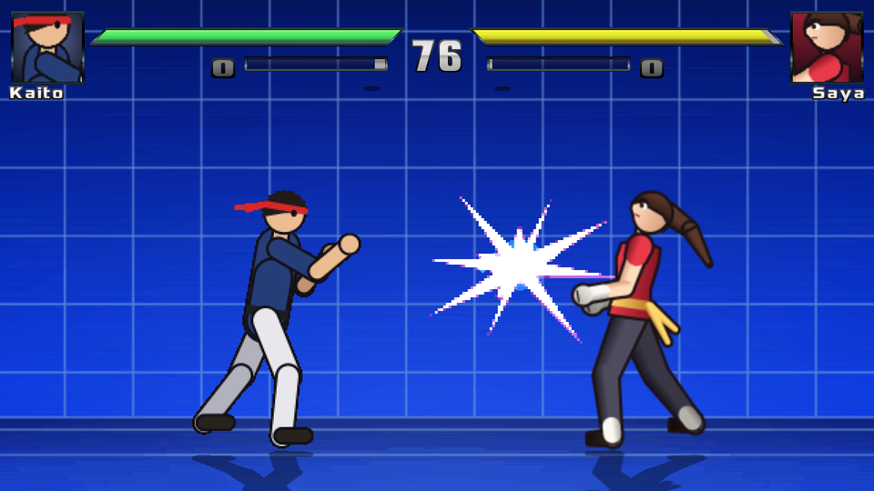
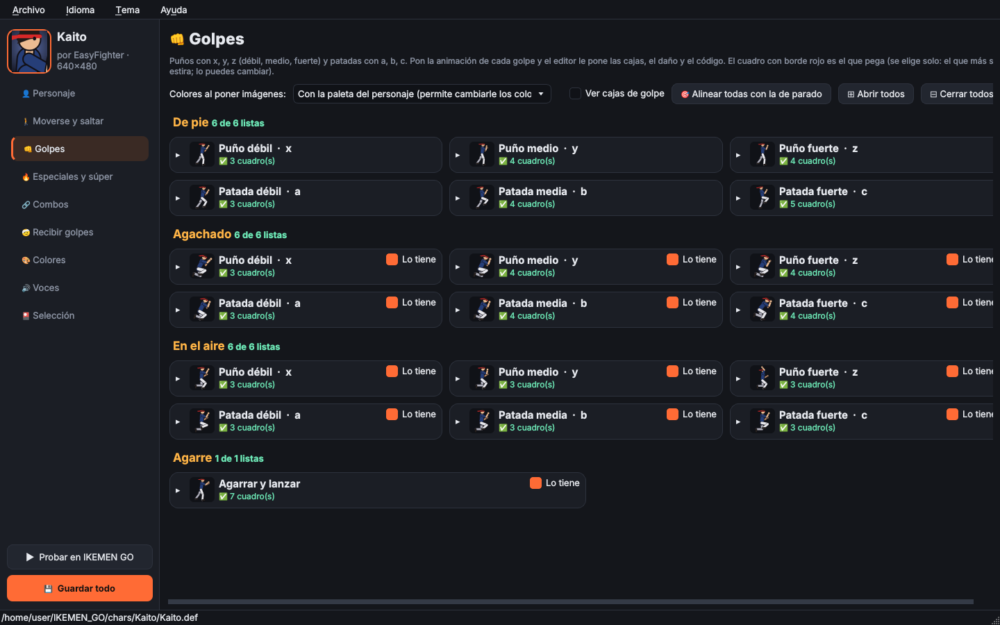
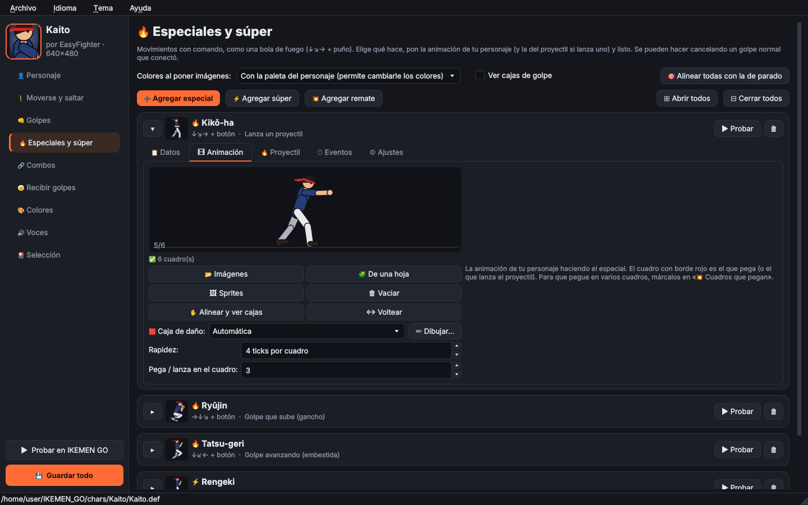
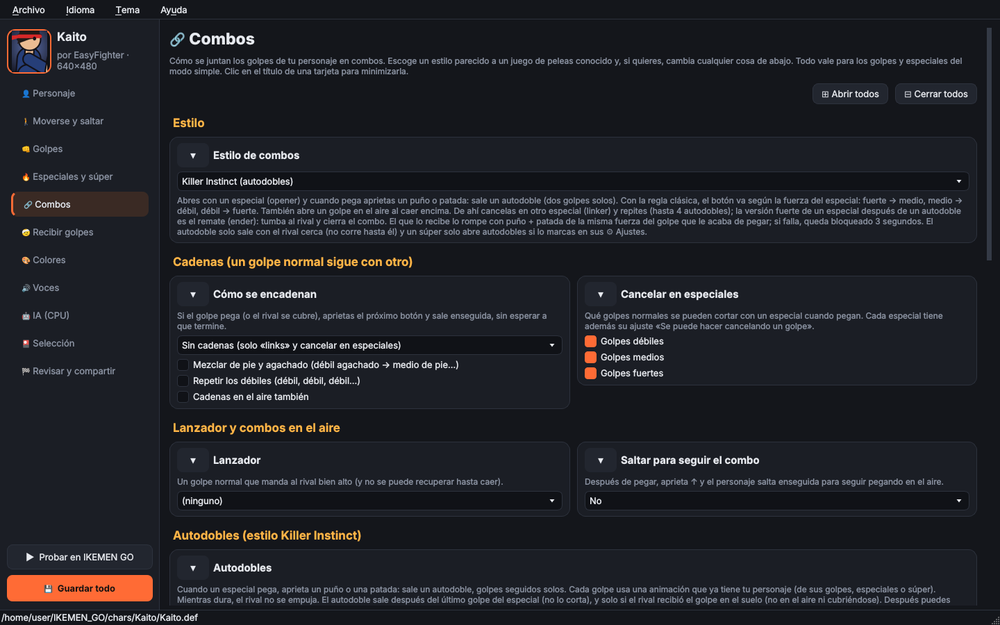
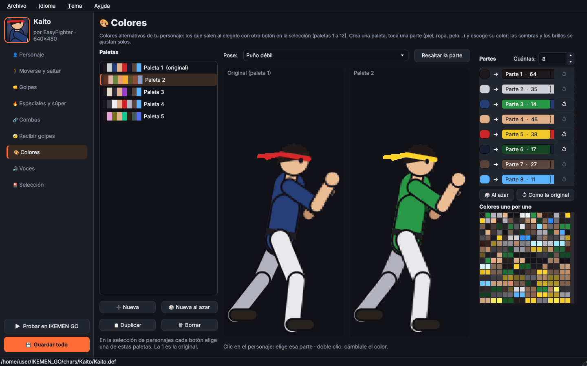
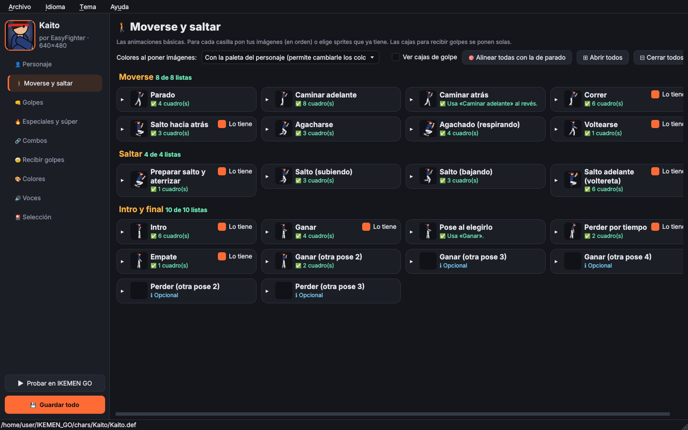
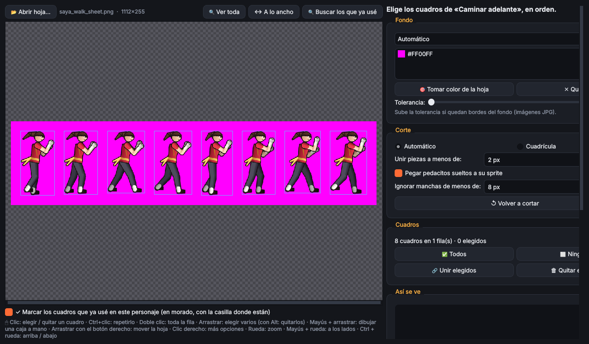
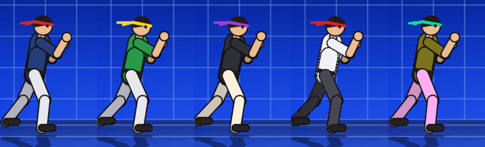

<h1 align="center">IKEMEN GO Character Editor</h1>

<p align="center">
  <b>Haz personajes de pelea para IKEMEN GO sin escribir código.</b><br>
  Pones tus dibujos en casillas, escoges qué hace cada golpe y el editor arma el resto.
</p>

<p align="center">
  
  
  
  
  
</p>

<p align="center"><i>English: <a href="README.md">README.md</a></i></p>

<p align="center"></p>

> 🤖 **Hecho con inteligencia artificial.** El código, los dos personajes de ejemplo (Kaito y Saya, dibujados
> con código) y la documentación los escribió **Claude**, de Anthropic, en conversación con **Joan**, que puso
> las ideas, decidió cómo debía funcionar, lo probó y pidió los cambios. Se probó en IKEMEN GO, pero puede
> tener errores: si encuentras uno, abre un *issue*.

## ¿Qué es?

Un editor de personajes para **IKEMEN GO** (también abre personajes de MUGEN), al estilo de Fighter Factory,
pero pensado para que **cualquiera** pueda hacer un personaje:

- 🧸 **Modo simple:** casillas para cada animación (parado, caminar, golpes, especiales…). Pones tus imágenes
  o una hoja de sprites y el editor arma las animaciones, las cajas de golpe y todo el código.
- 🔥 **Especiales y súper** con comandos (↓↘→, →↓↘, cargar…): proyectiles, ganchos, embestidas, agarres,
  contraataques y remates.
- 🔗 **Combos** al estilo Street Fighter, Marvel, Guilty Gear o **Killer Instinct** (autodobles, remates y
  combo breaker).
- 🎨 **Colores alternativos** con un clic por parte (piel, ropa, pelo…), 🔊 **voces** en WAV, OGG o MP3 y
  🧩 un **cortador de hojas de sprites**.
- ▶ **Probar en IKEMEN GO** con un botón, y 🛠 herramientas avanzadas (sprites, animaciones y código a
  mano) para quien las necesite.
- 🌎 En español, English, Português, Français, Deutsch e Italiano.

**📖 Para empezar, mira la [guía paso a paso](docs/GUIA.md).**

## Capturas

| | |
|---|---|
|  **Golpes:** una casilla por golpe |  **Especiales:** comando, animación y qué hace |
|  **Combos:** escoges un estilo |  **Colores:** toca una parte y escoge el color |
|  **Moverse y saltar** |  **Cortador de hojas de sprites** |

<p align="center"></p>

## Instalar y abrir

Necesitas Python 3.10 o más nuevo.

- **Manjaro / Arch:** `sudo pacman -S python-pyqt6 python-numpy`
- **Cualquier sistema:** `pip install -r requirements.txt`

Luego: doble clic en `main.py`, o `python3 main.py` (o `python3 main.py ruta/al/personaje.def`).

Probado en Linux (Manjaro) con IKEMEN GO. Al ser Python debería funcionar también en Windows y macOS.

## Personaje de ejemplo

En la pantalla de inicio (**🥋 Personaje de ejemplo**) o en **Archivo → «🥋 Personajes de ejemplo»**
escoges uno, le pones el nombre que quieras (o le dejas el suyo) y el editor lo copia a donde digas con
ese nombre —la carpeta y todos los archivos— y lo abre, para usarlo de base. Los dos están hechos completos solo con el modo
simple (todas sus animaciones, 18 golpes, agarre, 3 especiales y súper), con dibujos originales libres:

- **Kaito** (`ejemplos/Kaito`): combos al estilo Killer Instinct (autodobles, remate, combo breaker).
- **Saya** (`ejemplos/Saya`): combos al estilo Street Fighter, con un dibujo más detallado.

La lista de movimientos de cada uno está en su `LEEME.txt`.

## Sacar los sprites de otro personaje

**Archivo → Personaje nuevo → «Con los sprites de otro personaje»**, o con doble clic en
`extraer_sprites.py` (o `./extraer_sprites.py origen.def carpeta_nueva [nombre]`): crea un personaje
nuevo con el código de la plantilla, le copia los sprites, paletas y sonidos del otro, y pone sus
animaciones en las casillas del modo simple (parado, caminar, saltar, recibir golpes, poses de victoria,
golpes normales, agarre, especiales y súper con su comando). Al abrirse en el editor ya se arma todo:
revisa cada casilla, alinea si hace falta y guarda.

Cada casilla del modo simple tiene **↔ Voltear** (espejo, para imágenes que miran hacia la izquierda) y la
**rapidez en números** (ticks por cuadro); el cortador de hojas también tiene «↔ Voltear».

**Cajas de golpe en lo que pega:** el modo simple pone la caja roja (la que hace daño) solo en la punta de lo
que ataca —el puño, el pie, la rodilla—, comparando con la pose de parado. En cada golpe o
especial, **🟥 Caja de daño** escoge entre **Automática** y **A mano**: con **✏ Dibujar…** la mueves, la
estiras o dibujas otras cuadro por cuadro, y al guardar la animación pasa a «A mano» (solo pega lo que
dibujaste; lo ves igual en «✋ Alinear y ver cajas»). Si vuelves a «Automática», lo dibujado se guarda por si
regresas.

**Golpes que avanzan y que cambian al repetir:** cada golpe normal tiene «Avanza:» (un paso adelante o
atrás mientras pega) y «🔁 Al apretar otra vez» (hasta 3 animaciones más al apretar el mismo botón seguido,
o alternar entre dos).

## Qué hace

Tema oscuro con barra lateral y pantalla de inicio con tus personajes recientes (con su retrato; para sacar uno de la lista, ✕ o clic derecho, o «🧹 Limpiar la lista»).
Abajo a la izquierda: **💾 Guardar todo** y **▶ Probar en IKEMEN GO** (abre una pelea rápida con tu
personaje: eliges rival, escenario, nivel de la CPU, paleta, sin límite de tiempo, poder lleno y **nadie se
muere**: la pelea va en modo entrenamiento, la vida se rellena sola y nadie cae KO; para eso el editor pone
un archivo pequeño, `external/mods/chareditor_test.lua`, que solo se activa cuando lo abre el editor).

### 🧸 Modo simple y 🛠 modo avanzado

El editor siempre abre en el **modo simple**. Las herramientas avanzadas están escondidas en **Archivo → 🛠 Herramientas
avanzadas…** (pide confirmación; para volver, el botón «🧸 Volver al modo simple» de abajo a la izquierda):

- **🧸 Modo simple** — para hacer un personaje sin tocar código. Todo son casillas: en cada una pones tus
  imágenes (📂, en orden por nombre) o eliges sprites que ya tiene (🖼), escoges la rapidez y la ves
  animada. El editor arma solo las animaciones, las cajas de golpe y el código.
  - **👤 Personaje**: nombre, autor, vida, ataque, defensa, saltos en el aire, **tiempo tirado en el suelo** antes de levantarse, **tamaño** (con vista previa) y **🔍 agrandar los sprites a ese tamaño** (los agranda de verdad,
    con sus animaciones y cajas, y deja el tamaño en 100 %),
    ancho del cuerpo, altura, barras de poder, sombra y rebote al caer; si está dentro de IKEMEN GO/chars,
    ponerlo en la pantalla de selección y su **música** (la de su escenario, la de victoria y la de poca vida,
    en `data/select.def`).
  - En **🚶 Moverse y saltar**, **👊 Golpes** y **🤕 Recibir golpes** cada casilla viene **cerrada** (▸): en la
    fila ves una miniatura y lo que le falta (**⚠ Falta poner sprites** en naranja, **✅** lista, **ℹ** usa lo
    que ya tenía), y cada grupo dice cuántas tiene listas («3 de 7 listas»). Ábrela con un clic o usa
    «⊞ Abrir todos / ⊟ Cerrar todos».
  - Los movimientos que no todos los personajes tienen traen un tick **Lo tiene**: correr (→→), salto hacia
    atrás (←←), voltearse, preparar salto, voltereta, cubrirse en el aire, tropezar, recuperarse en el aire,
    mareado, intro, ganar, perder por tiempo, empate, los golpes agachado y en el aire, y el agarre. Si se lo
    quitas, la casilla dice **⭘ No lo tiene** (cuenta como lista) y el juego usa otra animación en su lugar
    (voltearse → el primer cuadro de «Parado», tropezar → «Sale volando», ganar → «Parado»…). Correr y el
    salto hacia atrás además se apagan en el .cmd, y los golpes apagados no se generan. Los esenciales
    (parado, caminar, agacharse, saltar, los golpes de pie, recibir golpes…) no tienen tick.
  - **Personajes descargados**: el modo simple lee el .cmd y los estados del personaje y muestra lo que ya
    tiene. Sus movimientos **se editan en su propio código**, así sus combos, cancelaciones y efectos siguen
    funcionando:
    - En **👊 Golpes**, las casillas de los golpes y el agarre que ya existen dicen **ℹ Ya lo tiene:
      «nombre»** (cuentan como listas). Si le pones imágenes, sprites o una hoja, o le cambias la rapidez, se
      cambia su animación (el mismo número de acción); el **Daño** se cambia en su HitDef. **📋 Rehacer en el
      modo simple** lo cambia por un golpe del modo simple (pierde lo especial de su código; vuelve si vacías
      la casilla).
    - En **🔥 Especiales y súper**, la sección **🎮 Los que ya tiene el personaje** muestra cada uno con sus
      versiones (débil / fuerte…). Abierto se le cambia la animación, el daño de cada versión y el comando
      (**🎮 Cambiar comando…**, cada versión se queda con su botón), todo en su código. El tick **Lo tiene** lo
      apaga.
    - **📋 Pasar al modo simple** / **📋 Pasar todos al modo simple** lo pasan al modo simple **sin perder
      nada**: cada controlador de su código se vuelve un **evento** editable (golpes, proyectiles, sonidos,
      movimientos, efectos…; lo que no se reconoce queda como «Código propio», tal cual). Conserva sus números
      de estado, y sus entradas del .cmd se quedan en su mismo lugar (el orden importa para los combos), solo
      que usan el comando del modo simple. El [Statedef] original se guarda renombrado y **↩ Original** /
      **↩ Devolver los originales** lo devuelven todo como estaba.
  - **🚶 Moverse y saltar**: parado, caminar (si dejas «atrás» vacía se usa «adelante» al revés), correr,
    salto hacia atrás, agacharse, voltearse, saltos, intro, ganar, perder, empate y la pose al elegirlo.
    Las casillas que mueven al personaje traen su **velocidad** (o altura y avance en los saltos) con:
    **🦶 A sus pasos** (caminar y correr: mide los pasos para que los pies no patinen), **📏 A su tamaño**
    (saltos y salto hacia atrás: altura y distancia según lo grande que es) y **▶ Probar** (lo ves
    moverse sobre un piso con marcas).
  - **👊 Golpes**: puño y patada débil / medio / fuerte (x y z, a b c) de pie, agachado y en el aire, más el
    **agarre** (→ + botón cerca del rival). El cuadro que pega se elige solo (el que más se estira, con
    borde rojo) y lo puedes cambiar; también el daño. La patada fuerte agachado es una barrida.
  - **🔥 Especiales y súper**: cada uno es una fila que se abre y se cierra (▸ / ▾, o «Abrir / Cerrar todos»)
    con pestañas **Datos**, **Animación**, **Proyectil** y **⚙ Ajustes** (cuántos golpes y cada cuántos ticks,
    pausa, empuje, daño al cubrirse, si lo tumba / lo lanza (no, **con el último golpe** —los de antes lo dejan aturdido de pie— o con cada golpe), cómo se cubre, juggle, invencibilidad, velocidad de la
    embestida, si **se detiene al pegar** (en vez de seguir de largo empujando al rival), avance y altura del gancho, poder que gana o barras que gasta, pausa y oscuridad del súper,
    si se puede cancelar). Además: comando (↓↘→, →↓↘, cargar…), botón de puño o patada, versiones débil / media /
    fuerte, y qué hace: **lanzar un proyectil** (con su animación y la de cuando choca), golpe en el lugar,
    embestida o gancho que sube. El súper gasta una barra y oscurece la pantalla.
    **🎮 Crear…** abre el creador de comandos: tocas las flechas en orden (y si quieres «cargar» la primera,
    o escoges **Apretar el botón mientras caminas** → / ← para un golpe que sale caminando, solo o
    después de las flechas) y queda guardado en tu lista para usarlo en cualquier especial. En los proyectiles eliges **de dónde
    salen** (adelante / altura, o automático desde la mano) y su **velocidad**, y **▶ Probar** muestra el
    especial con un rival de prueba y **todos sus eventos** (impulsos, despegue, teletransporte, proyectiles y
    efectos, estela, destellos, sacudidas, pausa), con la caja de golpe en rojo en los cuadros que pegan (ahí
    también puedes tocar el punto de salida). Las pruebas tienen **rapidez** (100% a 10%), **⏸ pausa** y
    **⏮ ⏭ tick a tick** para verlas con calma.
    En **🎞 Animación**, **💥 Cuadros que pegan** muestra cada cuadro como un botón: marca todos los que llevan
    caja de golpe. Cada grupo de cuadros seguidos es un golpe y el daño se reparte entre ellos (sin marcar
    ninguno, pega en el cuadro de «Pega / lanza en el cuadro», como antes).
    Más opciones: tipos **agarre especial** (de cerca, no se puede cubrir), **contraataque** (atrapa el golpe
    del rival) y **sin golpe** (solo movimiento o efectos); versión **EX** (dos botones juntos, gasta media
    barra, brilla y pega más); se puede hacer **en el suelo, en el aire o en los dos**; el súper se puede
    hacer **cancelando un especial**; el proyectil puede subir, acelerar o **caer como granada**.
    **«Qué hace» se arma con eventos**: al escoger el tipo, sus movimientos aparecen en **⏱ Eventos** marcados
    «del tipo» y se cambian ahí (el gancho trae un «Moverse / impulso» que **sale volando** en el cuadro que
    quieras, con su fuerza hacia adelante y hacia arriba, su **rapidez (%)** y si **cambia con la versión**; la
    embestida trae «avanzar» y «frenar»; el que lanza un proyectil trae el evento «🔥 Proyectil», que es el mismo
    de la pestaña «Proyectil»: se edita en cualquiera de los dos; el súper trae su «pausa con destello», en la que el personaje se queda quieto en ese cuadro mientras
    pasa el destello y después sigue).
    La pestaña **⏱ Eventos** agrega cosas que pasan en un cuadro de la animación (con ▲▼ para el orden y
    ⧉ para duplicar): **moverse / impulso**, **moverse de golpe**, **teletransporte** (detrás o delante del
    rival), **voltearse**, **quedarse quieto** (flotar), **otro golpe** (con su daño y cuántas veces pega),
    **otro proyectil** (con su animación, velocidad, aceleración y de dónde sale), **efecto** (una animación
    aparte: fuego, aura, chispas…, desde el personaje, el rival o la pantalla), **sonido**, **invencible**,
    **contraataque**, **sacudir la pantalla**, **destello de color**, **estela**, **pausa con destello** (se le puede quitar la chispa),
    **pausa del personaje** (solo él se congela, con o sin brillo; el rival y los proyectiles siguen), **color en
    la pantalla** (un fogonazo), **transparente / invisible**,
    **poder**, **vida**, **seguir con otro especial** (si conecta, si aprietas un botón o al terminar: para
    cadenas y combos) y **código propio** (para lo que no esté en la lista).
  - **🤕 Recibir golpes**: cubrirse (de pie, agachado, en el aire), golpe en la cara, en la panza, agachado,
    salir volando, caer, chocar con el suelo, tirado, levantarse, tropezar, recuperarse y mareado.
  - **🔗 Combos**: escoges un estilo — **Básico**, **Street Fighter** (links, repetir los débiles, cancelar
    en especiales), **Marvel / Darkstalkers** (cadenas débil → medio → fuerte, lanzador y combos en el aire),
    **Guilty Gear** (gatling, saltar después de cualquier golpe y «Roman cancel» con energía) o **Killer
    Instinct** (opener → autodoble → linker → autodoble → **remate**: autodobles después de un especial que
    pega, cada golpe con su animación y sin empujar al rival; **regla de botones** libre como KI 2013 o
    clásica como KI 1994 — fuerte → medio, medio → débil, débil → fuerte —; la versión fuerte de un especial
    después de un autodoble es el **remate (ender)**, que hace daño extra, tumba y cierra el combo; límite de
    golpes; y **combo breaker por fuerza**: puño + patada de la misma fuerza del golpe que te acaba de pegar,
    con **bloqueo** de unos segundos si fallas) — y cambias lo que quieras:
    cómo se encadenan los golpes, qué golpes se cancelan en especiales, el lanzador, saltar con ↑ para seguir
    el combo, cada autodoble (con qué especial inicia, qué animación usa cada golpe y su rapidez en %, escogida de los golpes,
    especiales y súper que ya tiene el personaje — «no pega» avisa las que no tienen caja roja), **▶ Probar
    combo** (armas el combo entero, especial → autodoble → especial…, y lo ves animado con la cuenta de
    golpes y control de rapidez), los botones y el costo del combo breaker y de cancelar
    con energía, menos daño en combos largos y ticks de aturdimiento extra para que los combos conecten.
    Los autodobles son una **lista** (➕ cuantos quieras de débil, medio o fuerte, con el botón y el especial
    que los abre, incluso el súper o una embestida), salen **después del último golpe** del especial sin
    cortarlo, y se arman también en el **🎨 creador visual** (galería de animaciones, tira de golpes con
    rapidez y vista animada). Las tarjetas de la pestaña se **minimizan** con clic en el título. En
    «Especiales y súper» hay **💥 Agregar remate** para hacer enders propios; con «Remate de» un remate usa el mismo comando de un especial
    (con el botón fuerte, como en KI) y solo sale después de un autodoble, que ya no se interrumpe.
    Como en Killer Instinct 2: máximo de **autodobles por combo** (4; el último tumba), **caer encima con un
    golpe en el aire** abre autodobles, el **remate cierra el combo** y el **combo breaker de KI2** (un botón de
    la fuerza del golpe: puño si fue alto, patada si fue bajo).
  - **Poses de más**: en «Intro y final» hay casillas opcionales para **otras poses de victoria y de
    derrota**; al ganar (o perder por tiempo) sale una al azar. Lo que tiene «Lo tiene» sin marcar (correr,
    salto atrás, recuperarse en el aire o movimientos del personaje) ya **no responde** a su comando.
  - **🎨 Colores**: colores alternativos (paletas 1 a 12, las que salen al elegirlo con otro botón). Los colores
    se agrupan solos en **partes** (piel, ropa, pelo…): tocas una (en la lista o con clic en el personaje) y
    escoges su color, y sus sombras y brillos se ajustan solos. También **🎲 Nueva al azar** (colores que
    combinan; la piel y los contornos se quedan), colores uno por uno, duplicar, borrar y comparar con la original
    en distintas poses. Se guardan en el SFF (1,n) o en el `.act` si el `.def` la trae así. Como en IKEMEN GO las
    paletas no cambian los sprites de 32 bits, un botón **pasa los sprites a la paleta del personaje** (hasta 255
    colores compartidos, casi igual que antes; los retratos se quedan; se puede deshacer).
  - **🔊 Voces**: al pegar, agarrar, especial, súper, remate, recibir un golpe, KO, ganar e intro (WAV, OGG, MP3, FLAC…), en secciones
    que se abren y se cierran. **Cada especial, súper o remate puede tener su propia voz** (en esa página o en la
    pestaña «📋 Datos» del movimiento); si no tiene la suya, usa la general de su tipo, y también se le puede quitar.
  - **🎴 Selección**: la cara de la casilla, el retrato grande, el de victoria y el personaje animado,
    con vista previa (pones una imagen o la sacas de un sprite con recorte y se ajusta sola al tamaño).

  En cada casilla, **✋ Alinear y ver cajas** abre los cuadros en grande: los arrastras a su lugar (con el
  cuadro anterior de guía, el suelo y el eje), «🦶 Pies al suelo» los acomoda solos, y ves las cajas de
  golpe (azul: donde le pegan · rojo: donde pega). Con «Ver cajas de golpe» también salen en las casillas.

  **🎯 Alinear con la de parado** (en esa misma ventana) y **🎯 Alinear todas con la de parado** (arriba en
  Moverse y saltar, Golpes, Especiales y Recibir golpes) reconocen en cada cuadro el **cuerpo** (tronco y
  cabeza, quitando brazos y piernas) y los **pies**, comparan cada cuadro con el anterior para que la
  animación no brinque, y lo anclan todo a la animación de parado. Cada animación tiene su modo, que se escoge
  solo y se puede cambiar: *Suelo: pie fijo* (golpes, cubrirse, recibir golpes), *Suelo: cuerpo fijo*
  (parado, caminar, correr, agarres, especiales), *Aire: golpes*, *Aire: vueltas y caídas* y *Acostado*.
  «Alinear todas» enseña antes y después con la de parado de guía, y se deshace con Ctrl+Z.

  Lo que hace el modo simple se guarda en `<personaje>.simple.json`; el código va en
  `<personaje>_simple.st` y en dos bloques marcados del `.cmd`, que se rehacen solos cada vez (no se
  duplica nada). Con «Colores al poner imágenes» eliges colores exactos (recomendado) o pasarlos a la
  paleta del personaje.
- **🛠 Modo avanzado** — todo lo de abajo, a mano, como en Fighter Factory. Si abres algo que hace el modo simple
  (el `_simple.st`, lo que está entre las marcas «SIMPLE-MODE» del `.cmd` o una de sus animaciones) sale un
  aviso amarillo, y al primer cambio te recuerda que eso se vuelve a armar y lo editado a mano se pierde.

### 🧩 Cortador de hojas de sprites

En cada casilla del modo simple (botón **🧩 De una hoja**), en 🎴 Selección (**🧩 Sacar de una hoja…**, para la
cara, el retrato y el de victoria) y en la pestaña Sprites (**🧩 Cortar hoja…**).
Abres una hoja de sprites (sprite sheet) y la corta sola:
- **Fondo automático**: usa la transparencia o el color del borde; también reconoce un segundo color de
  relleno y las **líneas de una cuadrícula** dibujada. Con 🎯 tomas más colores de la hoja; la **tolerancia**
  (sale sola en JPG) quita además el borde manchado del fondo.
- **Cortes precisos**: cada cuadro se recorta solo con **sus** píxeles (aunque las cajas se crucen no se
  cuela nada del vecino); los pedacitos sueltos (pelo, chispas, gotas) se pegan a su sprite; las manchas
  diminutas se ignoran; si dos sprites quedaron pegaditos los separa.
- **En orden**: por filas, de izquierda a derecha, con número en cada cuadro elegido.
- **Elegir fácil**: clic en un cuadro, doble clic para toda la fila, arrastrar para varios; unir o quitar
  cajas, o dibujar una a mano con Mayús + arrastrar. También hay modo **cuadrícula** (celdas de tamaño fijo).
- **Repetir cuadros**: **Ctrl+clic** en un cuadro lo pone otra vez al final (o clic derecho → **⧉ Agregarlo
  otra vez**), así armas 1-2-3-2-1 con un cuadro que en la hoja sale una sola vez. Cada cuadro marca en qué
  posiciones va (por ejemplo «2,5»). Debajo de la vista previa está la **tira con el orden**: arrastras para
  cambiarlo, o usas ⧉ Repetir, ◀ ▶ y ✖ Quitar. Un cuadro repetido se guarda una sola vez como sprite.
- **Eje automático**: suelo común de cada fila (lo que salta queda en el aire), los pies de cada cuadro, **el
  centro con los pies en el piso** (centrado de lado a lado pero sin quedar enterrado) o el
  centro; en el centro de los pies, así no «brinca» cuando estira un brazo o una pierna.
- **Agrandar los cuadros** al cortarlos (sin ponerlos borrosos), para hojas chiquitas.
- **Cuadros ya usados**: los que ya cortaste para este personaje salen marcados en morado con el nombre de
  la casilla donde están (con el ratón encima se ve completo). Se pueden esconder con su casilla y, con clic
  derecho, **✖ Olvidar que ya lo usé**. Si vuelves a cortar una casilla, sus marcas se cambian por las nuevas.
  **🔍 Buscar los que ya usé** compara los dibujos de la hoja con los sprites de tus casillas y marca los
  que ya están (para lo que cortaste antes); se hace solo la primera vez que abres una hoja sin marcas.
- **Vista previa animada** antes de agregarlos. Recuerda la última hoja y sus ajustes, para ir llenando
  casillas una tras otra.
- En el avanzado: grupo inicial, un grupo por fila, crear una animación por fila y tipo de colores.

### Modo avanzado

**Archivo → ✨ Personaje nuevo**
- Desde la **plantilla**: crea un personaje que se puede jugar enseguida en IKEMEN GO, con una figura
  provisional, todas las animaciones que pide el juego y un golpe de ejemplo (botón *a*). Elige la
  resolución: 320×240 (MUGEN clásico), 640×480 o 1280×720 (HD); las medidas se ajustan solas.
- **Copiando** otro personaje para usarlo de base (le cambia el nombre).

**Fondos**: las vistas de Sprites, Animaciones y Simulador tienen fondo con el suelo a la altura de los
pies del personaje. Hay 12 para escoger (dojo, atardecer, ciudad de noche, bosque, playa, templo, montaña
nevada, entrenamiento, pantalla verde, negro, gris y los cuadritos de siempre) o puedes poner **tu propia
imagen**; con 🌓 se oscurece para ver mejor las cajas. La elección se recuerda y vale para las tres vistas.

**📝 Datos** — lo del `.def`: nombre, autor, versión, resolución, paletas por defecto, archivos
(✅ / ❌ si existen), paletas `pal1…pal12` y storyboards. También se puede editar como texto.

**🖼 Sprites**
- Lista rápida aunque el SFF tenga miles de sprites (solo se dibujan los que se ven).
- Mover el **eje** arrastrando el sprite (o con flechas; Shift = de 10 en 10). Sprite de referencia
  semitransparente (el 0,0 o el anterior) para alinear.
- **Agregar imágenes** (PNG, BMP, GIF, PCX…): grupo y número del nombre del archivo (`200-3.png`),
  colores pasados a la paleta del personaje, paleta propia o 32 bits; eje abajo al centro, al centro o 0,0.
- **🖌 Editor de píxeles** (Ctrl+E o doble clic): lápiz, borrador, relleno, cuentagotas, línea,
  rectángulo, seleccionar y mover, copiar/pegar, voltear, girar, cambiar un color por otro, tamaño del
  lienzo, recortar, poner el eje; con deshacer.
- **🧰 En lote**: eje, paleta, renumerar o exportar varios sprites a la vez.
- Reemplazar, exportar uno o todos (con `axes.txt`, que guarda los ejes para volver a importarlos),
  duplicar, borrar, recortar bordes transparentes y ordenar.
- **Paletas**: ver el sprite con cualquier paleta del personaje, cambiar colores (doble clic),
  abrir/guardar `.act`, crear paletas nuevas, cambiar la paleta de un sprite.
- Abre SFF v1 y v2; guarda siempre **SFF v2** (lo que no cambiaste se copia tal cual, así que guardar es
  rápido). Los SFF v1 se convierten con la paleta correcta.

**🎞 Animaciones**
- **Panel del cuadro** (como en Fighter Factory): grupo, número, desplazamiento con flechitas, tiempo,
  voltear (ninguno / horizontal / vertical / ambos), transparencia (ninguna / suma / suma suave / resta /
  mezcla con origen y destino), dónde empieza la repetición, escala y ángulo; cada dato con «⇶» para
  usarlo en todos los cuadros.
- **💻 Código de la animación**: ver y editar a mano el texto (.air) de la acción elegida.
- Acciones con su nombre, cuadros en tabla (grupo, número, X, Y, tiempo, voltear, transparencia,
  escala y ángulo de IKEMEN), reproducción a 60 fps con velocidad, cuadro anterior semitransparente y
  vista mirando a la izquierda.
- **Cajas de golpe**: dibujar Clsn2 (cuerpo) y Clsn1 (golpe), moverlas y estirarlas con el ratón,
  flechas para ajustar, Supr para borrar; copiar las del cuadro anterior o usarlas en todos los cuadros.
- **🪄 Cajas automáticas** a partir de la parte visible del sprite (una caja o cabeza + cuerpo), en un
  cuadro o en toda la acción.
- **🎬 Exportar a GIF** animado.
- Agregar de una vez todos los sprites de un grupo como cuadros.
- Solo se reescriben las acciones que cambias: los comentarios y el formato del resto quedan igual.

**💻 Código** (`.cns`, `.cmd`, `.st`, `.zss`, `.ai`…)
- Colores, números de línea, **autocompletado** con todos los controladores y triggers de IKEMEN GO
  (Ctrl+Espacio), lista para saltar a cada `[Statedef]`, `[State]` o `[Command]`.
- **Ayuda al pasar el ratón** sobre un controlador o trigger: qué hace y sus parámetros.
- Buscar / reemplazar (Ctrl+F, F3), ir a la línea (Ctrl+G).
- **🔍 Revisar errores** (F7): `[State]` sin `type` o sin `trigger1`, controladores desconocidos,
  paréntesis o comillas sin cerrar, `[Statedef]` repetidos, y avisos si un `ChangeState`, `ChangeAnim` o
  `PlaySnd` apunta a algo que no existe en el personaje.

**🧪 Simulador** — elige un `[Statedef]` y míralo moverse: física (S/C/A), gravedad, VelSet, PosAdd,
ChangeState, ChangeAnim, variables, cuándo se activa el golpe (HitDef), sonidos, trayectoria y cajas.
Puedes marcar botones como presionados y ver tick a tick qué controladores se ejecutaron (doble clic
te lleva a esa línea del código). Los estados comunes del juego no se simulan: ahí termina.

**🥊 Movimientos** — asistente para crear un movimiento completo: comando (↓↘→, →↓↘, carga, etc.),
especial / súper / normal, de pie / agachado / en el aire, la animación desde un grupo de sprites con
sus cajas, el golpe (daño, altura, fuerza, empuje, si lo tira) o un **proyectil**, avance o salto y
sonido. Muestra el código antes de agregarlo, y lo pone en el .cmd (antes de los normales), en el
archivo de estados y en el .air.

**🔊 Sonidos** — escuchar, agregar sonidos (grupo y número del nombre del archivo), reemplazar, exportar,
borrar y renumerar. Dentro del `.snd` IKEMEN GO solo toca WAV (la música sí puede ser OGG, MP3…), así que al
poner un **OGG, MP3, FLAC, OPUS, M4A…** el editor lo convierte solo a WAV PCM de 16 bits (también un WAV raro,
como de 32 bits o comprimido). Usa `ffmpeg` si lo tienes instalado; si no, el decodificador que trae PyQt6.

**Para todo**
- Deshacer / rehacer (Ctrl+Z / Ctrl+Shift+Z) en sprites, animaciones y sonidos.
- **Archivo → 💾 Guardar todo** (Ctrl+S). El título muestra ● si hay cambios sin guardar.
- Antes de sobrescribir un archivo, se guarda una copia en `_editor_backups/<fecha>/` dentro de la
  carpeta del personaje.
- Idiomas: español, English, Português, Français, Deutsch, Italiano (menú **Idioma**; se aplica al
  volver a abrir). Para agregar otro, copia `lang/en.json`, cambia `_name` y traduce los valores.
- Temas: Oscuro (naranja), Claro, Medianoche (azul), Arcade (morado y rosa), Bosque (verde) y Alto contraste
  (menú **Tema**; cambia al momento y se queda guardado).

## Crear ejecutables (Windows, macOS, Linux)

Para que alguien use el editor sin instalar Python, se arma un ejecutable. Cada sistema arma el suyo
(PyInstaller no puede hacer el de Windows desde Linux), así que hay dos formas:

**En tu computadora (el de tu sistema):**
```bash
pip install -r requirements.txt pyinstaller pillow
python3 packaging/build.py                 # carpeta + .tar.gz (Linux) o .zip (Windows / macOS)
python3 packaging/build.py --appimage      # Linux: además un .AppImage (necesita appimagetool)
python3 packaging/build.py --onefile       # un solo archivo (abre más lento)
python3 packaging/build.py --version 1.0   # versión en el nombre de los archivos
```
Todo queda en `dist/`.

**Los tres a la vez con GitHub:** el repo trae `.github/workflows/build.yml`. En la pestaña **Actions** →
**Ejecutables** → **Run workflow**, GitHub arma los de Windows, macOS (Apple Silicon) y Linux (.tar.gz y
.AppImage) y los deja en «Artifacts». Si subes una etiqueta de versión, además crea un **Release** con los
archivos para descargar:
```bash
git tag v1.0
git push origin v1.0
```
En macOS, como no está firmado, la primera vez se abre con clic derecho → Abrir.

## Archivos del proyecto

```
main.py            arranque
core/              formatos: sff.py, air.py, snd.py, deffile.py, codeinfo.py, template.py, project.py,
                   simple_gen.py (código del modo simple), selectdef.py (select.def y música),
                   sheetcut.py (cortador de hojas)
ui/                ventana y pestañas
lang/              traducciones
ejemplos/          los personajes de ejemplo (Kaito y Saya)
packaging/         build.py: arma el ejecutable · .github/workflows: lo arma en GitHub
docs/              la guía y las capturas
```

## Licencia

[MIT](LICENSE): lo puedes usar, cambiar y compartir libremente, siempre que mantengas el aviso de la licencia.
Los personajes de ejemplo (Kaito y Saya) son originales y van con la misma licencia.

IKEMEN GO es un proyecto aparte, de sus propios autores: <https://ikemen-engine.github.io/>.

### Avisos

- **Dependencias:** PyQt6 (GPL v3 o licencia comercial de Riverbank Computing) y numpy (BSD). El código de
  este proyecto es MIT, que es compatible con la GPL. Si algún día repartes **ejecutables** que traen PyQt6
  adentro (PyInstaller, AppImage…), ese paquete queda bajo la GPL v3: incluye la licencia de PyQt6 y deja
  disponible el código fuente (este repositorio).
- **Capturas del juego:** salen de IKEMEN GO (MIT) con su screenpack de fábrica: barras de vida de Ohmga
  Shironeko ([CC BY 3.0](https://creativecommons.org/licenses/by/3.0/)) y fuentes de MUGEN de Elecbyte
  ([CC BY-NC 3.0](https://creativecommons.org/licenses/by-nc/3.0/)). Kaito y Saya son de este proyecto.
- **Marcas:** IKEMEN GO, MUGEN, Fighter Factory, Street Fighter, Killer Instinct, Marvel, Darkstalkers y
  Guilty Gear son de sus dueños. Aquí solo se nombran para describir estilos de juego; este proyecto no está
  afiliado con ninguno de ellos.
- **Sprites de otros personajes:** el editor puede sacar los sprites de otro personaje. Úsalo con
  personajes tuyos o con permiso de sus autores, y no publiques personajes hechos con sprites ajenos sin ese
  permiso.
