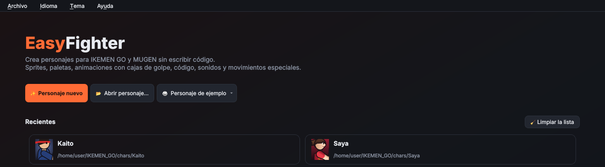
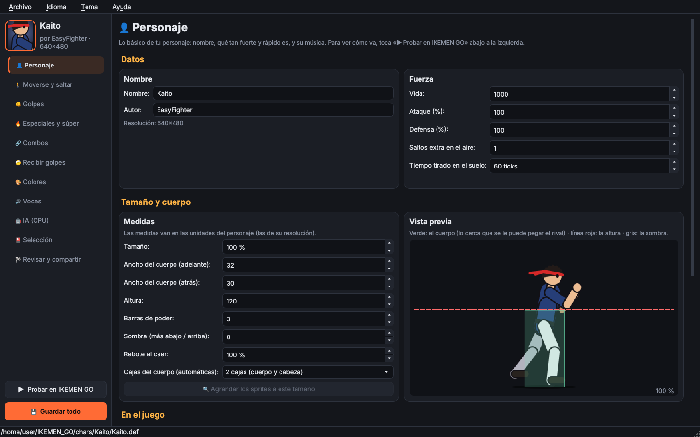
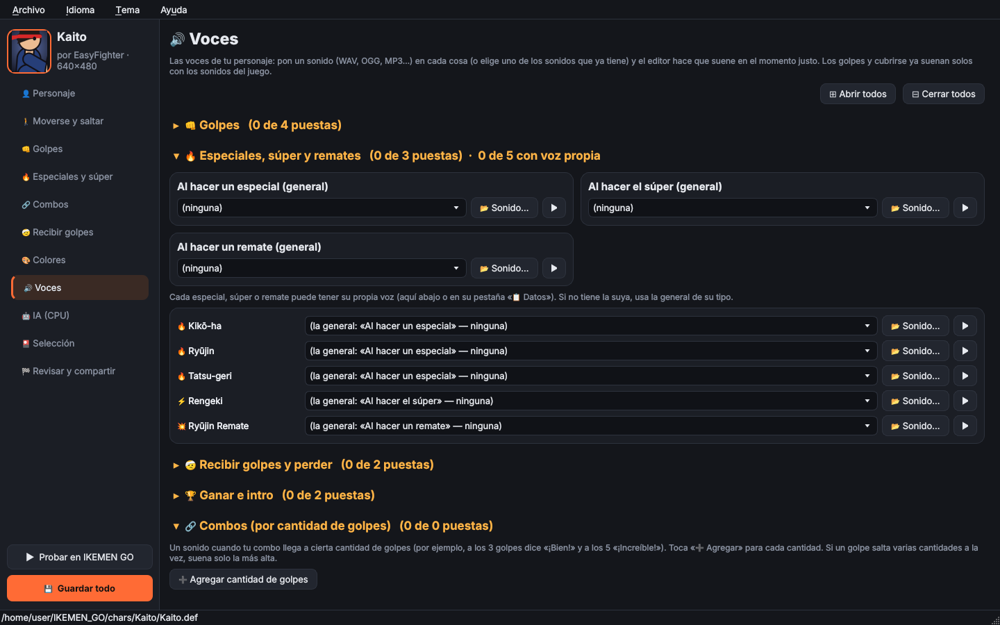

# Guía: tu primer personaje

Esta guía te lleva de cero a un personaje que se puede jugar en IKEMEN GO, usando solo el **modo simple**
(sin escribir código). Para todo lo que hace el editor, mira el [README](../README.es.md).

*English: [GUIDE.md](GUIDE.md)*

---

## Antes de empezar

1. **Ten IKEMEN GO** descargado en alguna carpeta (la que tiene `chars/`, `stages/` y `data/`).
2. **Instala lo que necesita el editor** (Python 3.10 o más nuevo):
   - Manjaro / Arch: `sudo pacman -S python-pyqt6 python-numpy`
   - Cualquier sistema: `pip install -r requirements.txt`
3. **Abre el editor**: doble clic en `main.py` (en Linux debe tener permiso de ejecución) o
   `python3 main.py` en la terminal.

> 💡 Si quieres ver cómo queda un personaje terminado antes de hacer el tuyo, en la pantalla de inicio toca
> **🥋 Personaje de ejemplo** y escoge **Kaito** o **Saya**. Le pones el nombre que quieras (o le dejas el
> suyo) y el editor lo copia con ese nombre a la carpeta que digas y lo abre: puedes ver cada casilla, probarlo en el
> juego o usarlo de base para el tuyo.

## Paso 1 · Crear el personaje

Toca **✨ Personaje nuevo**:

- **Nombre** y **autor**.
- **Crear dentro de:** escoge la carpeta `chars` de tu IKEMEN GO, así lo pruebas enseguida.
- **Resolución:** el tamaño de tus dibujos. 320×240 es el de MUGEN clásico; 640×480 o 1280×720 para
  dibujos más grandes.
- **Cómo empezar:**
  - *Desde la plantilla*: un personaje que ya se puede jugar, con una figura provisional. Tú le vas
    cambiando las animaciones.
  - *Con los sprites de otro personaje*: toma los dibujos de otro personaje y los pone solos en las
    casillas. También existe `extraer_sprites.py` para hacerlo sin abrir el editor.

## Paso 2 · 👤 Personaje

Nombre, vida, ataque, defensa y el **tamaño**. La vista previa te enseña el cuerpo (verde: lo cerca que se le
puede pegar), la altura (línea roja) y la sombra. Abajo lo puedes poner en la **pantalla de selección** y
escogerle música.

## Paso 3 · 🚶 Moverse y saltar

Cada animación es una **casilla**: parado, caminar, agacharse, saltar, correr, ganar, intro… En cada una:

| Botón | Qué hace |
|---|---|
| **📂 Imágenes** | Pones tus PNG/BMP/GIF; van en orden por nombre (`walk_01.png`, `walk_02.png`…). |
| **🧩 De una hoja** | Abre el **cortador de hojas**: detecta cada cuadro de una hoja de sprites y quita el fondo. |
| **🖼 Sprites** | Usa sprites que el personaje ya tiene. |
| **↔ Voltear** | Para imágenes que miran hacia la izquierda (el personaje siempre mira a la derecha). |
| **Rapidez** | Ticks por cuadro: 60 ticks = 1 segundo. Menos = más rápido. |
| **✋ Alinear y ver cajas** | Mueve los cuadros si quedaron desalineados y te enseña las cajas. |
| **🟦 Cuerpo** | Las cajas azules (donde le pueden pegar): automáticas o, con **✏ Dibujar…**, a mano. En «👤 Personaje» escoges si las automáticas son 1 o 2. |

> 💡 Empieza por **Parado**: es la guía. Cuando tengas varias, **🎯 Alinear todas con la de parado** las
> pone en el mismo lugar para que el personaje no «brinque» entre animaciones.

## Paso 4 · 👊 Golpes

Los 18 golpes normales (puño y patada débil, medio y fuerte; de pie, agachado y en el aire) y el agarre.
Para cada uno pones la animación y escoges **en qué cuadro pega**. El editor hace el resto: daño, cajas,
sonido, a quién le pega.

- **🟥 Caja de daño**: la caja roja (la que hace daño). En **Automática** va sola en la punta de lo que pega
  (el puño, el pie). Con **✏ Dibujar…** la mueves o la dibujas cuadro por cuadro, y la animación pasa a
  **A mano**: solo pega lo que dibujaste.
- **Avanza:** si el golpe debe dar un paso adelante.
- **🔁 Al apretar otra vez**: animaciones distintas si aprietas el mismo botón seguido (una ráfaga, o
  alternar entre dos).
- Si tu personaje no tiene algún golpe, desmárcalo («Lo tiene»).

## Paso 5 · 🔥 Especiales y súper

**🔥 Agregar especial**, **⚡ Agregar súper** o **💥 Agregar remate**. Cada uno tiene pestañas:

- **Datos:** nombre, **comando** (↓↘→, →↓↘, cargar…, o crea uno tuyo con 🎮), botón, **qué hace**
  (proyectil, golpe en el lugar, embestida, gancho, agarre, contraataque…), daño y su voz.
- **Animación:** la animación y en qué cuadro pega (o lanza el proyectil).
- **Proyectil:** la animación del proyectil y la de cuando choca.
- **⏱ Eventos:** cosas que pasan en un cuadro: moverse, otro golpe, sonido, efectos…
- **⚙ Ajustes:** golpes, empuje, si **lo tumba** (con el último golpe o con cada uno), cómo se cubre,
  invencibilidad, poder que gana o gasta… **Abre autodobles** deja seguir el combo con un autodoble después de
  él (estilo Killer Instinct; solo con el rival cerca). Los especiales la traen marcada y los súper no.

Con **▶ Probar** lo ves en acción contra un rival de prueba sin salir del editor.

## Paso 6 · 🔗 Combos

Escoge un **estilo** y el editor arma las reglas: **Básico**, **Street Fighter**, **Marvel / Darkstalkers**,
**Guilty Gear** o **Killer Instinct** (autodobles, remates y combo breaker). Después puedes cambiar cada regla.
Con **🎨 Crear combo visual** armas un combo escogiendo las animaciones y lo ves antes de probarlo.

## Paso 7 · 🤕 Recibir golpes

Cómo reacciona cuando le pegan, cuando cae y cuando se cubre. Las que dejes vacías usan lo que ya tenía.

## Paso 8 · 🎨 Colores

Colores alternativos: los que salen al escogerlo con otro botón en la selección.

1. Si te sale el aviso de **sprites en color verdadero**, toca **🎨 Pasar los sprites a la paleta del
   personaje** (en IKEMEN GO las paletas solo cambian los sprites de 8 bits).
2. **➕ Nueva** (o **🎲 Nueva al azar**).
3. Toca una **parte** (o haz clic en el personaje) y escoge su color: las sombras y los brillos se ajustan solos.

## Paso 9 · 🔊 Voces

Un sonido para cada cosa (al pegar, al hacer un especial, al recibir un golpe, al ganar…). Acepta WAV, OGG,
MP3, FLAC… y los convierte solo a WAV. Cada especial, súper o remate puede tener su propia voz.

En **🔗 Combos (por cantidad de golpes)** toca **➕ Agregar cantidad de golpes** para cada voz del combo: por
ejemplo, una a los 3 golpes y otra a los 5.

## Paso 10 · Probar y guardar

- **▶ Probar en IKEMEN GO** (abajo a la izquierda): pelea rápida con el rival, escenario y paleta que
  escojas. Puedes poner que nadie se muere y la barra de poder llena.
- **💾 Guardar todo** (Ctrl+S). Antes de sobrescribir, el editor guarda una copia en
  `_editor_backups/` dentro de la carpeta del personaje.

## Paso 11 · 🤖 IA (CPU)

Marca **Usar la IA de EasyFighter** para que la computadora pelee mejor con tu personaje: escoge qué tan
agresiva es, si hace combos, si usa el súper y cuándo usa cada especial. A ti, cuando juegas con él, no te
cambia nada.

## Paso 12 · 🏁 Revisar y compartir

1. **🔍 Revisar ahora**: te dice si falta algo (doble clic en un problema para ir a arreglarlo).
2. **📊 Calcular**: los datos de cuadros de cada golpe, para balancearlo.
3. **🕘 Historial de versiones**: el editor guarda fotos al guardar; con **↩ Volver a esta** regresas a una.
4. **📦 Crear el .zip…**: el personaje listo para compartir, con un `COMANDOS.txt`.

> 💡 También hay **🏆 Frases de victoria** en «👤 Personaje», y movimientos opcionales: **burla**, **dash en el
> aire**, **agarre en el aire**, **rebote en la pared**, **ayudante**, **rayo** (sus ajustes van juntos en la sección **🔦 Rayo** de ⚙ Ajustes) y
> **varios proyectiles**.

---

## Preguntas frecuentes

**¿Dónde quedan los archivos de mi personaje?**
En la carpeta que escogiste (por ejemplo `IKEMEN_GO/chars/MiPersonaje/`): `.def`, `.sff` (sprites), `.air`
(animaciones), `.cmd` (comandos), `.cns` y `_simple.st` (código), `.snd` (sonidos) y `.simple.json` (lo que
pusiste en el modo simple).

**¿Dónde guarda el editor su configuración?**
Linux: `~/.config/easyfighter/` · Windows: `%APPDATA%\easyfighter\` ·
macOS: `~/Library/Application Support/easyfighter/`.

**El personaje flota, se hunde o «brinca» al cambiar de animación.**
Usa **🎯 Alinear todas con la de parado**, o **✋ Alinear y ver cajas** en la casilla que se ve mal.

**Un golpe no le pega al rival.**
Revisa en qué cuadro pega y la **🟥 Caja de daño**: la caja roja tiene que tocar al rival.

**No me sale un especial.**
Mira el comando en «Datos» (la flecha y el botón) y prueba con **▶ Probar**. Algunos comandos piden la
flecha aguantada mientras aprietas el botón.

**Cambié el idioma y algo sigue en español.**
Los nombres que están *dentro* de los archivos del personaje (animaciones, comentarios del código) se
escriben en el idioma que tenías al generarlos. Cuando cambias algo en el modo simple se vuelven a escribir
en el idioma actual.

**¿Puedo editar el código a mano?**
Sí: **Archivo → 🛠 Herramientas avanzadas…** (sprites, animaciones, código y sonidos como en Fighter
Factory). Lo que hace el modo simple (el `_simple.st`, las marcas «SIMPLE-MODE» del `.cmd` y sus
animaciones) se vuelve a armar cada vez que cambias algo en el modo simple; el editor te avisa.

## Atajos

| Atajo | Qué hace |
|---|---|
| Ctrl+S | Guardar todo |
| Ctrl+Z / Ctrl+Shift+Z | Deshacer / rehacer |
| Ctrl+N / Ctrl+O | Personaje nuevo / abrir |
| Rueda del ratón | Zoom (en vistas y en el cortador) |
| Shift + rueda | Mover a los lados |
