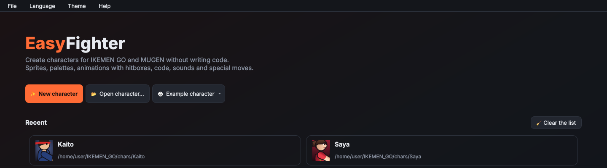
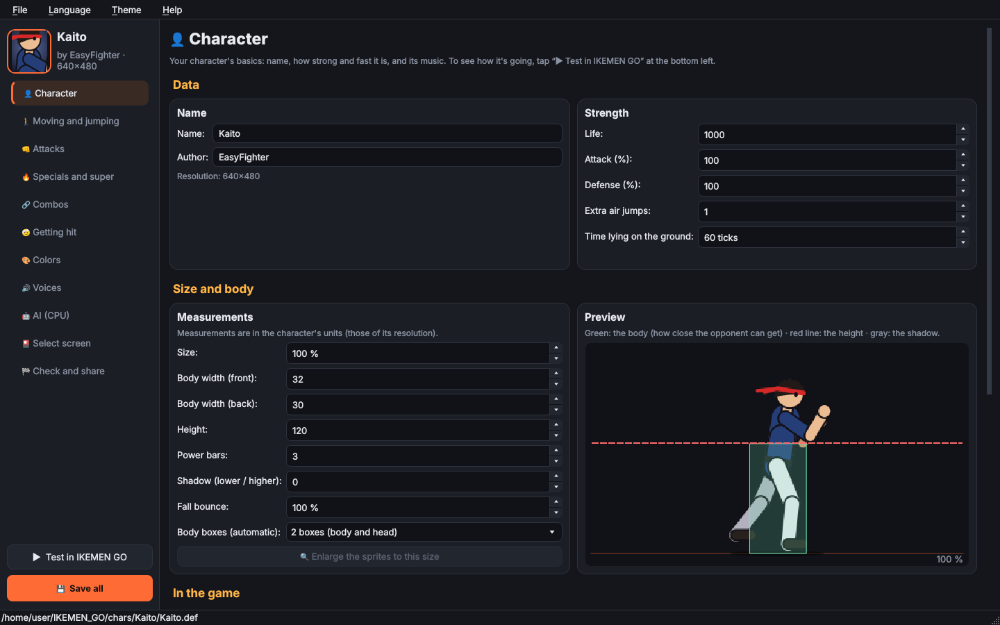
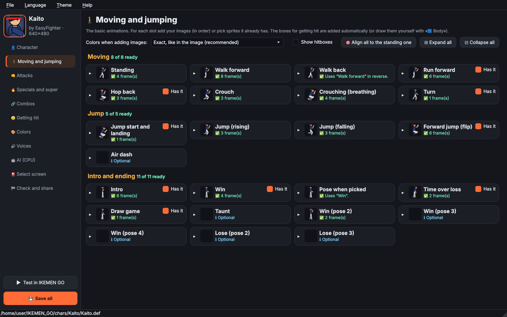
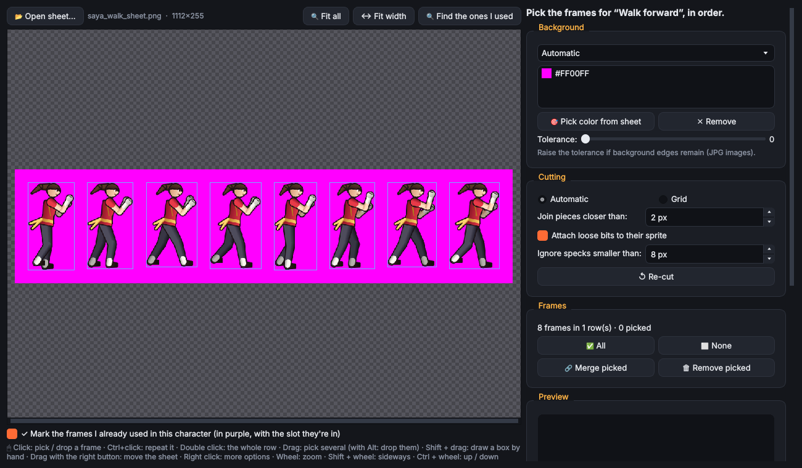
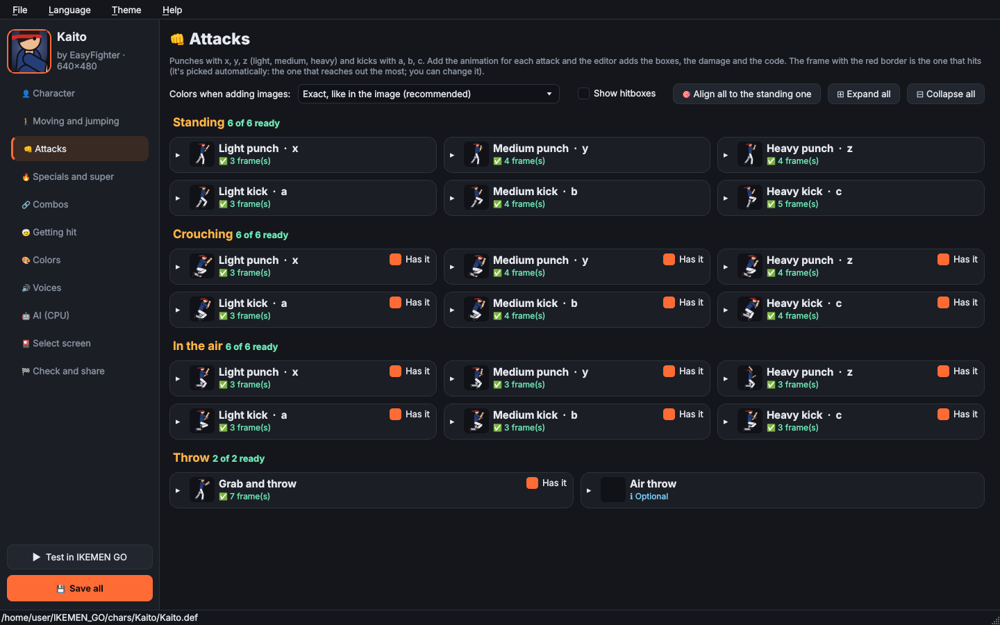
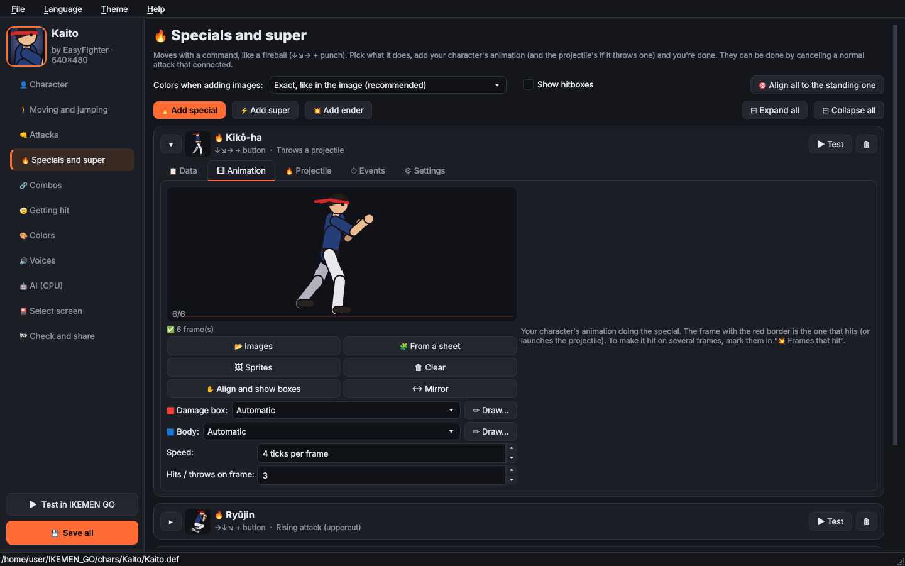
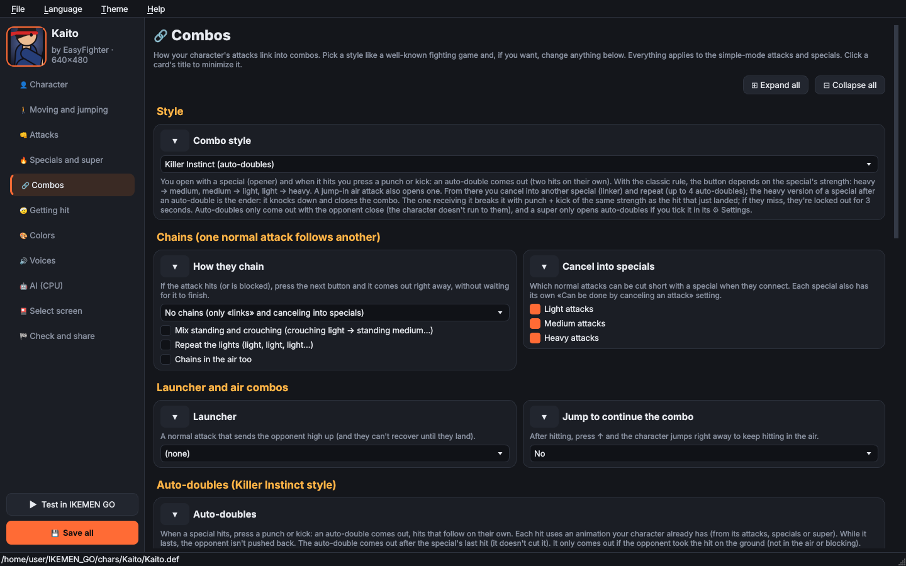
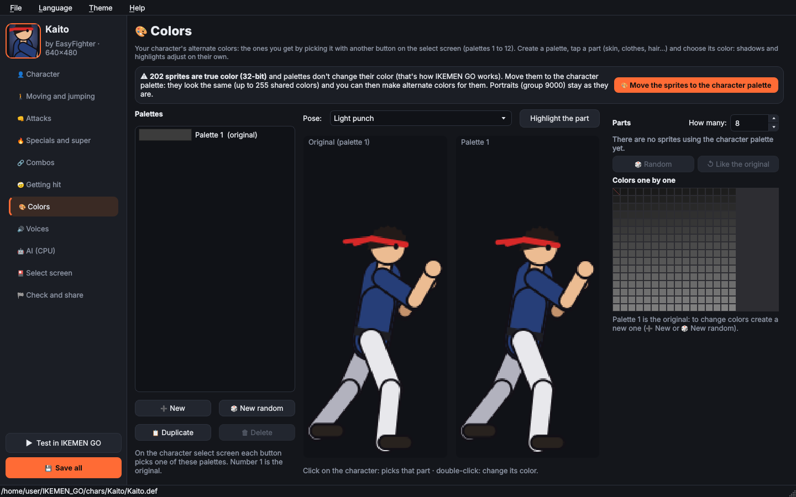
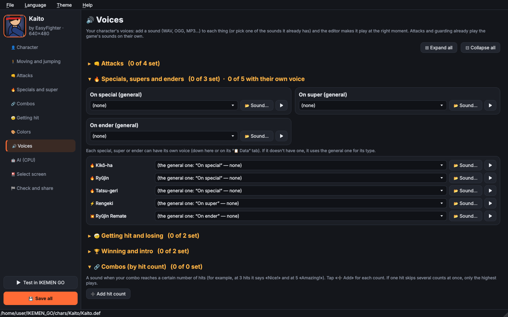

# Guide: your first character

This guide takes you from zero to a character you can play in IKEMEN GO, using only **simple mode** (no
code). For everything the editor does, see the [README](../README.md).

*Español: [GUIA.md](GUIA.md)*

---

## Before you start

1. **Have IKEMEN GO** downloaded somewhere (the folder with `chars/`, `stages/` and `data/`).
2. **Install what the editor needs** (Python 3.10 or newer):
   - Manjaro / Arch: `sudo pacman -S python-pyqt6 python-numpy`
   - Any system: `pip install -r requirements.txt`
3. **Open the editor**: double-click `main.py` (on Linux it needs execute permission) or run
   `python3 main.py` in a terminal.

> 💡 Want to see a finished character first? On the start screen click **🥋 Example character** and pick
> **Kaito** or **Saya**. Give it any name (or keep its own) and the editor copies it under that name to the folder you choose and
> opens it, so you can use it as a base or look at every
> slot and try it in the game.

## Step 1 · Create the character

Click **✨ New character**:

- **Name** and **author**.
- **Create in:** pick your IKEMEN GO `chars` folder so you can test it right away.
- **Resolution:** the size of your drawings. 320×240 is classic MUGEN; 640×480 or 1280×720 for bigger art.
- **How to start:**
  - *From the template*: a character that's already playable, with a placeholder figure. You replace its
    animations as you go.
  - *With another character's sprites*: takes another character's drawings and puts them in the slots for
    you. There's also `extraer_sprites.py` to do it without opening the editor.

## Step 2 · 👤 Character

Name, life, attack, defense and **size**. The preview shows the body (green: how close the opponent can
get), the height (red line) and the shadow. Further down you can add it to the **select screen** and pick its
music.

## Step 3 · 🚶 Moving and jumping

Each animation is a **slot**: standing, walking, crouching, jumping, running, winning, intro… In each one:

| Button | What it does |
|---|---|
| **📂 Images** | Add your PNG/BMP/GIF files; they go in name order (`walk_01.png`, `walk_02.png`…). |
| **🧩 From a sheet** | Opens the **sheet cutter**: it finds each frame on a sprite sheet and removes the background. |
| **🖼 Sprites** | Use sprites the character already has. |
| **↔ Mirror** | For images that face left (the character always faces right). |
| **Speed** | Ticks per frame: 60 ticks = 1 second. Fewer = faster. |
| **✋ Align and show boxes** | Moves frames that ended up misaligned and shows the boxes. |
| **🟦 Body** | The blue boxes (where it can be hit): automatic or, with **✏ Draw…**, by hand. In «👤 Character» you pick whether the automatic ones are 1 or 2. |

> 💡 Start with **Standing**: it's the reference. Once you have several, **🎯 Align all to the standing one**
> lines them up so the character doesn't "jump" between animations.

## Step 4 · 👊 Attacks

The 18 normal attacks (light, medium and heavy punch and kick; standing, crouching and in the air) and the
throw. For each one you add the animation and pick **which frame hits**. The editor does the rest: damage,
boxes, sound, who it can hit.

- **🟥 Damage box**: the red box (the one that does damage). On **Automatic** it goes on the tip of
  whatever hits (the fist, the foot) on its own. **✏ Draw…** lets you move it or draw it frame by frame, and
  the animation switches to **By hand**: only what you drew hits.
- **Moves:** if the attack should take a step forward.
- **🔁 When pressed again**: different animations when you press the same button repeatedly (a flurry, or
  alternating between two).
- If your character doesn't have some attack, untick it ("Has it").

## Step 5 · 🔥 Specials and super

**🔥 Add special**, **⚡ Add super** or **💥 Add ender**. Each one has tabs:

- **Data:** name, **command** (↓↘→, →↓↘, charge…, or make your own with 🎮), button, **what it does**
  (projectile, hit in place, rush, uppercut, special throw, counter…), damage and its voice.
- **Animation:** the animation and which frame hits (or throws the projectile).
- **Projectile:** the projectile animation and the one when it hits.
- **⏱ Events:** things that happen on a frame: moving, another hit, a sound, effects…
- **⚙ Settings:** hits, push, whether it **knocks down** (with the last hit or with every hit), how it's
  blocked, invincibility, power gained or spent… **Opens auto-doubles** lets the combo continue with an
  auto-double after it (Killer Instinct style; only with the opponent close). Ticked on specials, unticked on supers.

**▶ Test** shows it in action against a test opponent without leaving the editor.

## Step 6 · 🔗 Combos

Pick a **style** and the editor sets up the rules: **Basic**, **Street Fighter**, **Marvel / Darkstalkers**,
**Guilty Gear** or **Killer Instinct** (auto-doubles, enders and combo breakers). You can then change each
rule. **🎨 Visual combo maker** lets you build a combo by picking animations and watch it before testing it.

## Step 7 · 🤕 Getting hit

How it reacts when hit, when it falls and when it blocks. Any you leave empty use what it already had.

## Step 8 · 🎨 Colors

Alternate colors: the ones you get by picking it with another button on the select screen.

1. If you see the **true color sprites** notice, click **🎨 Move the sprites to the character palette** (in
   IKEMEN GO palettes only change 8-bit sprites).
2. **➕ New** (or **🎲 New random**).
3. Click a **part** (or click on the character) and choose its color: shadows and highlights adjust on
   their own.

## Step 9 · 🔊 Voices

A sound for each thing (on hit, on special, on getting hit, on winning…). It accepts WAV, OGG, MP3, FLAC… and
converts them to WAV automatically. Each special, super or ender can have its own voice.

In **🔗 Combos (by hit count)** tap **➕ Add hit count** for each combo voice: for example, one at 3 hits and
another at 5.

## Step 10 · Test and save

- **▶ Test in IKEMEN GO** (bottom left): a quick fight with the opponent, stage and palette you choose. You
  can make nobody die and keep the power bar full.
- **💾 Save all** (Ctrl+S). Before overwriting, the editor keeps a copy in `_editor_backups/` inside the
  character's folder.

## Step 11 · 🤖 AI (CPU)

Tick **Use the EasyFighter AI** so the computer fights better with your character: choose how aggressive it is,
whether it does combos, whether it uses the super and when it uses each special. When you play as it, nothing
changes for you.

## Step 12 · 🏁 Check and share

1. **🔍 Check now**: tells you if something is missing (double-click a problem to go fix it).
2. **📊 Calculate**: the frame data of each attack, to balance it.
3. **🕘 Version history**: the editor saves snapshots when you save; **↩ Go back to this one** returns to one.
4. **📦 Create the .zip…**: the character ready to share, with a `COMANDOS.txt`.

> 💡 There are also **🏆 Victory quotes** in «👤 Character», and optional moves: **taunt**, **air dash**, **air
> throw**, **wall bounce**, **helper**, **beam** and **several projectiles**.

---

## FAQ

**Where are my character's files?**
In the folder you picked (for example `IKEMEN_GO/chars/MyCharacter/`): `.def`, `.sff` (sprites), `.air`
(animations), `.cmd` (commands), `.cns` and `_simple.st` (code), `.snd` (sounds) and `.simple.json` (what you
set up in simple mode).

**Where does the editor keep its settings?**
Linux: `~/.config/easyfighter/` · Windows: `%APPDATA%\easyfighter\` ·
macOS: `~/Library/Application Support/easyfighter/`.

**The character floats, sinks or "jumps" when switching animations.**
Use **🎯 Align all to the standing one**, or **✋ Align and show boxes** on the slot that looks wrong.

**An attack doesn't hit the opponent.**
Check which frame hits and the **🟥 Damage box**: the red box has to touch the opponent.

**A special won't come out.**
Check the command in "Data" (the arrows and the button) and try it with **▶ Test**. Some commands need the
direction held while you press the button.

**I changed the language and something is still in Spanish.**
Names *inside* the character's files (animations, code comments) are written in the language you had when
they were generated. When you change something in simple mode they're rewritten in the current language.

**Can I edit the code by hand?**
Yes: **File → 🛠 Advanced tools…** (sprites, animations, code and sounds like in Fighter Factory). What simple
mode builds (the `_simple.st`, the "SIMPLE-MODE" marks in the `.cmd` and its animations) is rebuilt every time
you change something in simple mode; the editor warns you.

## Shortcuts

| Shortcut | What it does |
|---|---|
| Ctrl+S | Save all |
| Ctrl+Z / Ctrl+Shift+Z | Undo / redo |
| Ctrl+N / Ctrl+O | New character / open |
| Mouse wheel | Zoom (in views and in the sheet cutter) |
| Shift + wheel | Scroll sideways |
